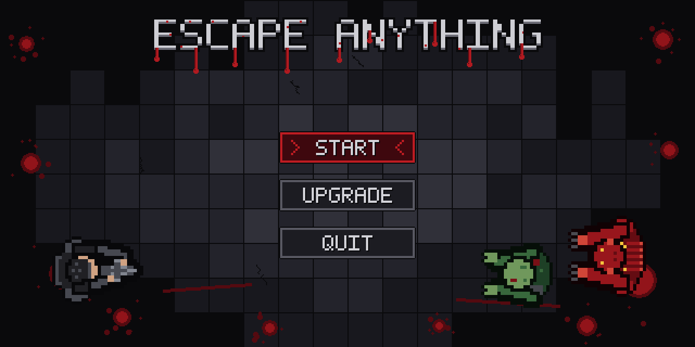
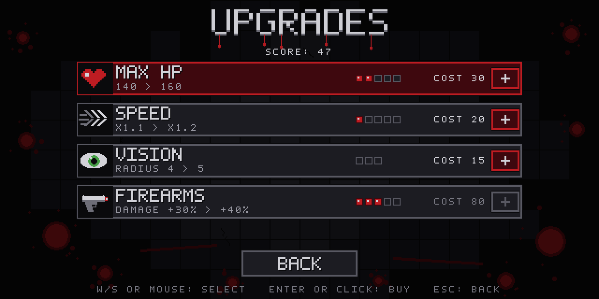
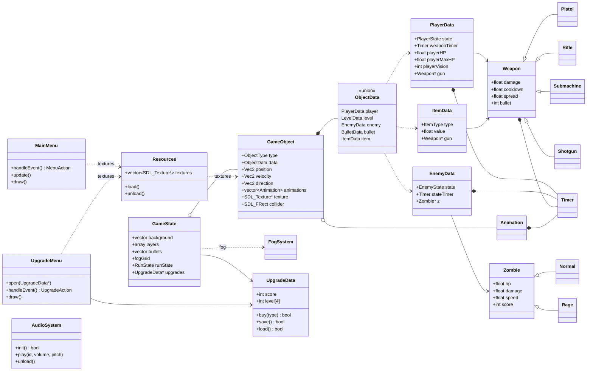
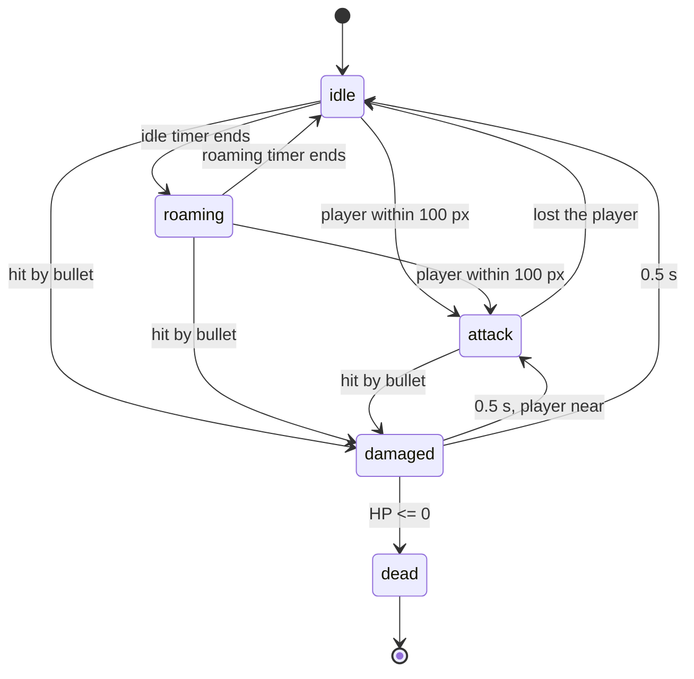
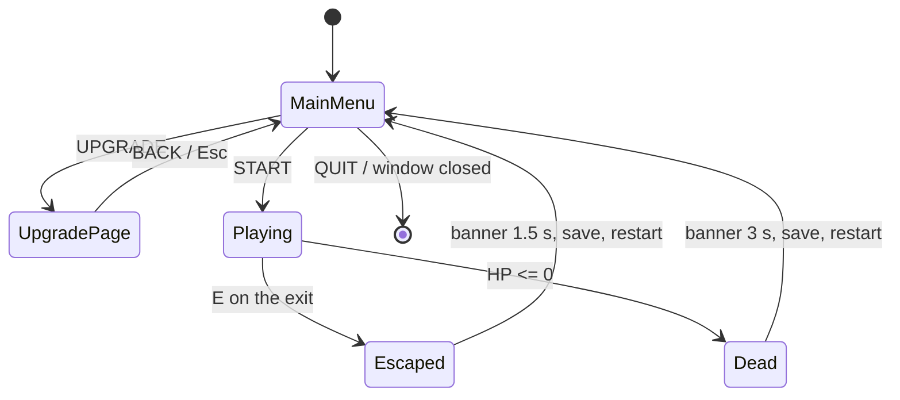
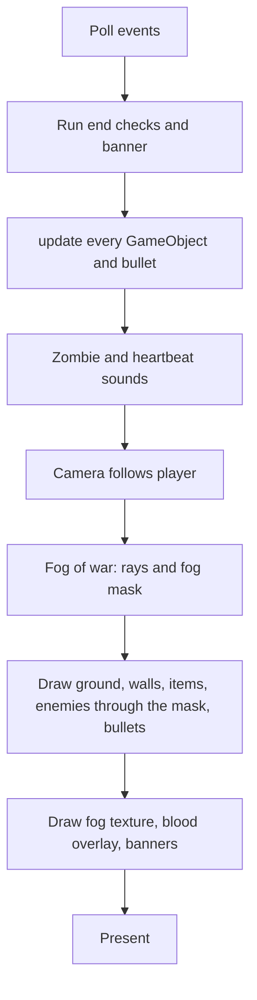
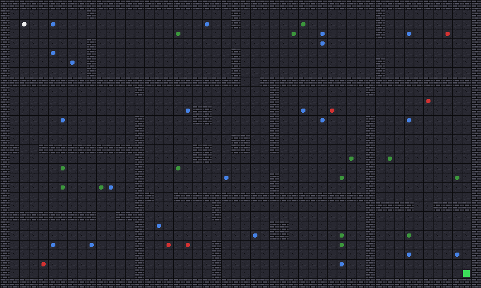
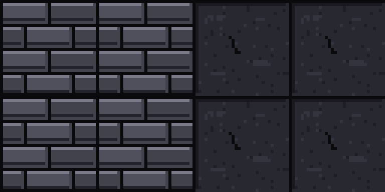
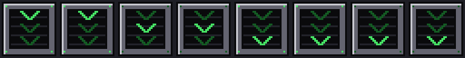

# Escape Anything

A top-down 2D zombie survival shooter written in **C++ and SDL3** for COMP3016 Coursework 1.
You explore a dark infected facility with a flashlight, shoot zombies, find the exit and spend the score you earn on permanent upgrades.

| | |
|---|---|
| **Video walkthrough (YouTube, unlisted)** | **TODO: paste link** |
| Genre | Top-down shooter / survival with fog of war and persistent upgrades |
| Language / API | C++ (Visual Studio 2022), SDL3 only |
| Resolution | 640 x 320 logical, 1280 x 720 window (resizable, letterboxed) |
| Platform | Windows 10 / 11 x64 |

<p align="center"> </p>

> The two images above are *asset previews* made while designing the screens. Real in-game screenshots are in [Sample screens](#11-sample-screens).

---

## Contents
1. [How to run](#1-how-to-run)
2. [Week 2 proposal and deviations](#2-week-2-proposal-and-deviations)
3. [Gameplay description](#3-gameplay-description)
4. [Dependencies](#4-dependencies)
5. [Use of AI](#5-use-of-ai)
6. [AI Development Log](#6-ai-development-log)
7. [Game programming patterns](#7-game-programming-patterns)
8. [Game mechanics and how they are coded](#8-game-mechanics-and-how-they-are-coded)
9. [UML design diagrams](#9-uml-design-diagrams)
10. [Project structure and assets](#10-project-structure-and-assets)
11. [Sample screens](#11-sample-screens)
12. [Exception handling and test cases](#12-exception-handling-and-test-cases)
13. [Playtesting evidence and reflection](#13-playtesting-evidence-and-reflection)
14. [Further details](#14-further-details-how-the-prototype-works)
15. [Evaluation](#15-evaluation)
16. [Repository evidence](#16-repository-evidence)

---

## 1. How to run

### Option A: the release (no Visual Studio needed)
1. Download `EscapeAnything.zip` from the [Releases page](../../releases) (or the DLE zip) and extract it.
2. Keep the folder structure: `EscapeAnything.exe`, `SDL3.dll` and the `Assets` folder (with `Assets/Sounds`) must stay together.
3. Double-click `EscapeAnything.exe`.

### Option B: build from source (Visual Studio 2022)
1. Open the solution, choose **Release / x64**.
2. SDL3 is referenced in *Project > Properties > VC++ Directories* (Include = `SDL3/include`, Library = `SDL3/lib/x64`) and `SDL3.lib` is linked. **TODO: write the exact paths you used.**
3. Build. Copy `SDL3.dll` and the `Assets` folder next to the `.exe` (the game loads files from the folder of the exe with `SDL_GetBasePath()`).
4. The save file `save.json` is created in the folder the game is started from.

### Controls

| Key | Action |
|---|---|
| **W A S D** | Move |
| **Mouse** | Aim (the player and the flashlight cone follow the mouse) |
| **Left mouse button** | Shoot |
| **E** | Pick up items / swap weapon / **use the exit** |
| **F10** | Debug mode (collision boxes and numbers) |
| Menu: **W / S** or arrows or mouse, **Enter / Space** or click | Select / confirm |
| **Esc** | Main menu: quit. Upgrade page: back. In game: nothing (a run only ends at the exit or by dying) |

---

## 2. Week 2 proposal and deviations

### 2.1 The proposal
**TODO (student): paste your Week 2 proposal here (title, genre, synopsis, core loop, intended mechanics, intended technical features, UML sketch, architecture overview, libraries, intended use of AI, roadmap).**

### 2.2 Deviations and why
**TODO (student): compare with your proposal and keep only the rows that are true.** These are the changes that happened during development (they come from the development conversation):

| Change from the plan | Why |
|---|---|
| Added permanent **upgrades** (max HP, speed, vision, firearms) saved in **JSON** | Gives the score a purpose and a reason to replay after dying |
| A run ends **only** at the exit (E) or by dying, then everything restarts | Clear win / lose condition and a repeatable core loop |
| Map grown to **30 x 50 tiles** with generated rooms and one exit | More exploration; makes the fog of war and flashlight matter |
| **Rage zombie** type (fast, strong, 5 points) | Variety and risk / reward |
| **Sound effects** with zombie proximity sounds | Atmosphere, and an audio warning when you can not see the zombie |
| Rendering optimisation of the fog of war | The bigger map made the game slow (details in section 14) |
| **TODO** | **TODO** |

---

## 3. Gameplay description

**Story (edit to match your proposal).** You wake up inside a dark, infected facility. Zombies roam the rooms. The only way out is the exit hatch at the far end. Every zombie you kill earns score you can turn into upgrades for the next attempt.

**Core loop**

```
Main menu -> (Upgrade page: spend score) -> START
   -> explore with a flashlight cone, pick up items and weapons
   -> shoot zombies for score, avoid damage (the screen bleeds as your HP drops)
   -> reach the exit and press E  = ESCAPED          \
   -> or HP reaches 0             = YOU DIED          /-> score saved -> new run on a fresh map
```

**What you do**
- You only see what your flashlight cone lights up. Explored but dark areas stay dimmed; unexplored areas are black. Walls block the light.
- Zombies wander, then chase you when you are within about 3 tiles. A zombie you can not see can still be heard.
- Items lie in the rooms: medkit (+50 HP), speed boost, flashlight (wider and longer light) and four weapons (pistol, assault rifle, submachine gun, shotgun). Weapons are random, and swapping drops your current weapon on the floor.
- A **normal** zombie gives 1 score, a **rage** zombie (faster, stronger) gives 5.
- The **UPGRADE** page turns score into permanent bonuses (they stay after death or escape).

**Weapons**

| Weapon | Damage | Cooldown (s) | Bullets | Spread |
|---|---|---|---|---|
| Pistol (start) | 10 | 0.4 | 1 | 10 |
| Assault rifle | 25 | 0.2 | 1 | 10 |
| Submachine gun | 15 | 0.1 | 1 | 10 |
| Shotgun | 8 | 0.8 | 8 | 40 |

(The player's effective cooldown is the weapon cooldown + 0.2 s, reduced by the Firearms upgrade.)

**Zombies**

| Type | HP | Damage | Speed | Score |
|---|---|---|---|---|
| Normal | 150 | 10 | 50 | 1 |
| Rage | 240 | 20 | 80 | 5 |

**Upgrades** (cost of the next level = base cost x (level + 1))

| Upgrade | Per level | Max level | Base cost |
|---|---|---|---|
| Max HP | +20 HP (100 to 200) | 5 | 10 |
| Speed | +10 % | 5 | 10 |
| Vision | +1 light radius | 3 | 15 |
| Firearms | +2 accuracy (less spread) and -0.04 s cooldown | 5 | 20 |

---

## 4. Dependencies

| Dependency | Use |
|---|---|
| **SDL3** (zlib licence) | Window, renderer, input, BMP loading, **audio** (SDL3's own audio streams, no extra library), timers, random numbers |

No other library is used (irrKlang, SDL_image and SDL_mixer are **not** used). Standard library only: `<vector>`, `<array>`, `<string>`, `<fstream>`, `<sstream>`, `<cmath>`.

---

## 5. Use of AI

Level declared: **Partnered Work** (signed declaration form is in the submission zip: `docs/Generative_AI_Declaration.docx`).

AI tool: **Claude** (Anthropic, Claude Sonnet 5.5). Summary:

- **Assets**: all pixel-art BMPs (items, characters, walk / death animations, blood overlay, menu, upgrade page, ground, wall, exit) were generated by Python scripts that Claude wrote from my specification (32 x 32, 4 – 8 colours, white = transparent) and that I reviewed and iterated. The 19 sound effects were synthesised by a Python script written by Claude. Scripts are in [`tools/`](tools).
- **Code**: Claude wrote the first version of `MainMenu.h`, `UpgradeMenu.h`, `UpgradeData.h` and `AudioSystem.h` and edit lists for `CW1.cpp`. I integrated them by hand and changed the design (for example the Firearms upgrade). The core engine (`GameObject.h`, `Timer.h`, `Animation.h` and the game loop, entity update, collision, fog of war in `CW1.cpp`) is my own work.
- **Debugging / optimisation**: Claude found a bug in my blood-overlay frame maths, diagnosed a null-pointer crash, and analysed the slow fog-of-war and collision loops.
- **Tests and documentation**: Claude helped write the unit tests in [`tests/`](tests) and drafted this report from the real project facts; I edited and checked it.
- **What AI did not do**: it never ran my game or my Visual Studio build, and it can not hear sounds. I compiled, played, listened, reported bugs and decided what to keep.

I can explain every AI-assisted part of the code (see the video).

---

## 6. AI Development Log

The full log is in [`docs/AI_DEVELOPMENT_LOG.md`](docs/AI_DEVELOPMENT_LOG.md) and the complete conversation export is in [`docs/AI_CHAT_LOG.md`](docs/AI_CHAT_LOG.md). In short:

- **Tools used**: Claude (Sonnet 5.5).
- **Categories of use**: sprite creation, animation creation, UI assets, texture generation, sound generation, code generation, debugging, optimisation, level design support, gameplay balancing, programming testing, documentation.
- **Example prompts**: e.g. *"32x32 pixel grid, max 4–8 colours, use RGBA 255,255,255,255 as a transparent background colour... a hard integer grid with no anti-aliasing"*; *"About the bleeding screen overlay... it can't render smoothly, this is my code, can you help me to check it?"*; *"can you use txt to tell me which part need to edit? Like last time, I would like to edit by myself."*; *"it's very slow now, any things can do to reduce the latency?"* (13 examples with results in the log).
- **Verification process**: asset scripts assert the rules (no key colour in a sprite, size, palette size); I reviewed previews and asked for changes (the blood overlay took 6 design rounds); new C++ was compile-checked with a stub of SDL3 and unit-tested; I played the game, found problems the AI could not (sound repeating, zombies colliding with corpses, low frame rate) and the fixes were verified again (13 cases in the log).
- **Repository evidence**: see [Repository evidence](#16-repository-evidence).

---

## 7. Game programming patterns

Following Robert Nystrom's *Game Programming Patterns*:

| Pattern | Where in the code | Why |
|---|---|---|
| **Game Loop** | `main()`: an outer loop (menu or upgrade page) and an inner `while (gaming)` loop with a delta time, vsync on | Same speed on any machine; menu and game have separate loops |
| **Update Method** | `update(state, gs, res, obj, deltaTime)` is called for every `GameObject`; behaviour depends on `obj.type` | One place to advance every entity |
| **State** | Enum state machines: `PlayerState` (idle, walking, dead), `EnemyState` (idle, roaming, attack, damaged, dead), `BulletState`, `RunState` (playing, escaped, dead), and the menu / upgrade / game modes | Clear behaviour per state, no tangled boolean flags |
| **Object Pool** | Bullets: `gs.bullets` reuses a bullet whose state is `inactive` before it pushes a new one | Avoids allocating and freeing a bullet for every shot |
| **Type Object** (data-driven types) | `Weapon` and `Zombie` base structs; `Pistol`, `Rifle`, `Submachine`, `Shotgun`, `Normal`, `Rage` only set stats | New weapon / zombie type = new stats, no new logic |
| **Flyweight** | `Resources` loads each texture once; every object keeps a pointer to the shared texture | One copy of each image in memory |
| **Data-driven level** | `createTiles()` turns the numbers in `map[][]` and `backgroundMap[][]` into objects | The level is data, easy to change (also generated by a script) |
| **Dirty list** (optimisation) | Fog of war: `visibleCells` remembers which cells were lit, so only those are reset each frame | Avoids scanning 1.5 million cells per frame |
| **Result enums instead of coupling** | `MainMenu::handleEvent()` returns a `MenuAction`; `UpgradeMenu::handleEvent()` returns an `UpgradeAction`; `main()` decides what to do | Menu classes know nothing about the game state |

---

## 8. Game mechanics and how they are coded

| Mechanic | How it is coded |
|---|---|
| **Movement** | WASD builds a direction; velocity accelerates (`acceleration = 300`) up to `maxSpeed` and slows down when no key is pressed (`update()`, player branch). `position += velocity * deltaTime` |
| **Aiming** | `SDL_GetMouseState` + `SDL_RenderCoordinatesFromWindow` give the mouse in logical coordinates (works with the letterbox); `atan2(dy, dx)` gives the player angle and the flashlight direction |
| **Shooting** | Left mouse button and a `Timer` (`weaponTimer`) set the fire rate; `spawnBullet()` computes the direction plus a random spread (`spread - accuracy`), the bullet is pooled |
| **Collision** | `checkCollision()` builds the two rectangles and uses `SDL_GetRectIntersectionFloat`; `collisionResponse()` decides by object type (wall pushes back along the smaller overlap axis, bullet hits, item pickup, exit, enemy contact). Only moving objects test collisions and only against objects within 2 tiles |
| **Enemy AI** | Per-zombie finite state machine with timers: idle (5 s), roaming (2.3 s, random direction), attack when the player is within 100 px, damaged (0.5 s flash), dead (animation then lies on the floor; corpses do not block zombies) |
| **Fog of war** | `fogHandle()` casts rays in the flashlight cone with Bresenham lines (`CastVisionRay()`); walls stop a ray; cells become *Visible*, then *Explored*. Enemies are drawn into an off-screen buffer and masked so you only see them inside the light. The fog is drawn by building one small texture each frame (`drawFog()`) |
| **Blood overlay** | A 24-frame sheet (4 x 6) animated by `Animation`; its alpha depends on `1 - HP / maxHP`, plus a red tint |
| **Items** | `ItemData` picks a random type; E applies it: speed (`maxSpeed += 5`), heal (+50 HP, capped), flashlight (+10 degrees field of view and +1 vision), weapon (swap pointers with the weapon on the floor, 1 s pick-up cooldown) |
| **Score and upgrades** | Killing a zombie adds `Zombie::score` to `UpgradeData::score`. `UpgradeMenu` calls `UpgradeData::buy()`. `applyUpgrades()` applies the levels at the start of a run (max HP, `maxSpeed`, vision, weapon cooldown); accuracy is used in `spawnBullet()` |
| **Save / load (JSON)** | `UpgradeData::toJson()` writes `{ "score": 47, "maxHp": 2, ... }` to `save.json`; `fromJson()` reads it, keeps defaults for missing values and clamps values to the valid range. Saved when you buy, when a run ends and when the game closes |
| **Run end and restart** | The exit tile is an `ObjectType::exit`; standing on it and pressing E sets `RunState::escaped`. Death sets `RunState::dead`. After a banner, `restartGame()` rebuilds the whole `GameState` (map, enemies, items, fog, player); only `UpgradeData` (outside the `GameState`) survives |
| **Sound** | `AudioSystem` loads 19 WAV files into SDL3 audio streams (16 voices mixed on one device). `updateZombieSounds()` makes the nearest living zombie within 260 px groan, growl or snarl; closer = louder and more often, quieter when out of sight. Anti-spam rules limit repeats |
| **Menus** | `MainMenu` (START / UPGRADE / QUIT) and `UpgradeMenu` use `handleEvent()`, `update()`, `draw()`; mouse position is converted with `SDL_ConvertEventToRenderCoordinates`; clicks count on release |

---

## 9. UML design diagrams

### 9.1 Class diagram



### 9.2 State diagrams





### 9.3 Frame flow



---

## 10. Project structure and assets

```
/                         CW1.cpp  GameObject.h  Timer.h  Animation.h
                          MainMenu.h  UpgradeMenu.h  UpgradeData.h  AudioSystem.h
Assets/                   all BMP images
Assets/Sounds/            19 WAV sound effects
docs/                     AI log, AI chat log, playtesting, images
tests/                    automated tests (see tests/README.md)
tools/                    Python scripts that generated the BMPs, the map and the sounds
```

Asset rules ("item spec"): BMP, 32 x 32 grid, at most 8 palette entries, RGB (255, 255, 255) is the transparent colour and is **palette entry 0** (the loader's `SDL_MapRGB(..., 255, 255, 255)` colour key resolves to index 0), hard pixel grid, no anti-aliasing. Sound: 16-bit, mono, 44.1 kHz WAV.
The generator scripts use absolute paths from the development machine, edit the `OUT` constants to run them.

---

## 11. Sample screens

**TODO (student): take real in-game screenshots (Win + Shift + S) and put them in `docs/screenshots/`, then link them here:**

| Screen | File |
|---|---|
| Main menu | `docs/screenshots/menu.png` |
| Upgrade page | `docs/screenshots/upgrade.png` |
| Gameplay with fog and flashlight | `docs/screenshots/gameplay.png` |
| Low HP with blood overlay | `docs/screenshots/low_hp.png` |
| Exit and "PRESS E TO ESCAPE" | `docs/screenshots/exit.png` |
| YOU DIED / ESCAPED banner | `docs/screenshots/banner.png` |

Design previews (generated, not screenshots):

| Level layout (green = normal zombie, red = rage zombie, blue = item, white = player, bright green square = exit) | Tiles (wall, ground) | Exit animation |
|---|---|---|
|  |  |  |

---

## 12. Exception handling and test cases

### 12.1 How errors are handled

| Situation | Behaviour |
|---|---|
| First launch / `save.json` missing | `UpgradeData::load()` returns false and keeps defaults (score 0, all levels 0) |
| `save.json` damaged, edited or with impossible numbers | Missing or unreadable values stay at the default, negative values become 0, levels are clamped to the maximum; no crash |
| No audio device | `AudioSystem::init()` returns false; `play()` does nothing; the game runs silently |
| A sound file is missing or has the wrong format | That sound is skipped (silent) |
| Invalid sound id | Ignored |
| `SDL_Init`, window or renderer creation fails | `initSDL()` reports failure and `main()` returns 1 |
| Not enough score / maximum level in the upgrade page | The purchase is refused and a message is shown ("NOT ENOUGH SCORE" / "ALREADY AT MAX LEVEL"); nothing changes |
| Window resized or minimised | Logical presentation keeps the aspect ratio; mouse positions are converted to logical coordinates |
| Closing the window during a run | The loop ends and the score is saved |
| Player dead | Input is ignored, zombies stop attacking, the run returns to the menu after 3 s |
| Dead zombie | Not pushed, does not block other zombies, bullets pass through |
| Missing BMP file | **TODO: write what happens in your final build** (with the optional patch in the submission checklist: an error message box and a clean exit) |

### 12.2 Automated tests ([`tests/`](tests))

| Test | Result |
|---|---|
| `test_upgrade_data.cpp`: buying, max level, not enough score, JSON round trip, missing file, damaged JSON | passed ("all checks passed") |
| `test_audio_antispam.cpp`: repeated hurt / hit / zombie voices / gunshots are limited | passed |
| `validate_map.py`: 30 x 50, solid border, 1 player, 1 exit, everything reachable | passed (335 walls, 21 items, 20 zombies, 42 targets reachable) |

**TODO (student): run them once more on your final files and copy the console output into `docs/test_output.txt`.**

### 12.3 Manual test cases

**TODO (student): run these (15 minutes), tick Pass or write what happened.**

| ID | Test | Steps | Expected | Result |
|---|---|---|---|---|
| T1 | Start | Menu: click START, also try Enter | Game starts, no click-through shot | ☐ |
| T2 | Window resize | Drag the window to another size | Picture keeps its ratio, aim still hits the mouse position | ☐ |
| T3 | Walls | Walk into every wall, corner and doorway | Player never passes a wall | ☐ |
| T4 | Shooting | Hold the mouse button | Fire rate follows the weapon; bullets vanish on walls | ☐ |
| T5 | Zombie damage | Let a zombie touch you | HP drops, red flash, blood overlay grows, hurt sound not spammed | ☐ |
| T6 | Kill zombie | Kill a normal and a rage zombie | Score +1 and +5; dead body does not block other zombies | ☐ |
| T7 | Death | Let HP reach 0 | "YOU DIED" for 3 s, menu, new run has a fresh map | ☐ |
| T8 | Items | Stand on a medkit / speed / flashlight and press E | Effect applied once, item disappears | ☐ |
| T9 | Weapon swap | Press E on a weapon, hold E | Weapons swap, 1 s cooldown, no flicker | ☐ |
| T10 | Exit | Stand on the exit, press E | "ESCAPED!" then menu; Esc in game does nothing | ☐ |
| T11 | Upgrade buy | Upgrade page with enough score | Level +1, score reduced, saved | ☐ |
| T12 | Upgrade refuse | Not enough score / max level | Message, nothing changes | ☐ |
| T13 | Persistence | Close the game, start again | Score and levels are kept | ☐ |
| T14 | Damaged save | Replace `save.json` with nonsense text | Game starts with defaults | ☐ |
| T15 | No `save.json` | Delete it | Game starts with defaults | ☐ |
| T16 | No sound folder | Rename `Assets/Sounds` | Game runs silently | ☐ |
| T17 | Quit mid-run | Close the window while playing | Score of the run is saved | ☐ |
| T18 | Upgrades in game | Buy Speed / Vision / Max HP, start | Player is faster / sees further / has more HP | ☐ |

---

## 13. Playtesting evidence and reflection

Full template and results: [`docs/PLAYTESTING.md`](docs/PLAYTESTING.md).

**TODO (student): fill in after your playtest.**

- **Who participated:** 
- **What was tested:** 
- **Feedback received:** 
- **Changes implemented (with commits):** 
- **Remaining limitations:** 

---

## 14. Further details: how the prototype works

- **Rendering**: logical size 640 x 320 scaled to the window with `SDL_LOGICAL_PRESENTATION_LETTERBOX`, nearest-neighbour scaling for crisp pixels. Order: ground, walls and items, characters, bullets, fog, blood overlay, text.
- **Colour key**: BMPs use white as the transparent colour (`SDL_SetSurfaceColorKey`). Important detail: for an 8-bit BMP the key resolves to palette index 0, so every asset has white at index 0.
- **Performance work** (the 30 x 50 map made the game slow): (1) fog drawing used one `SDL_RenderFillRect` per map pixel (up to about 1.5 million per frame), now one streaming texture; (2) the per-frame reset of the fog grid scanned 1.5 million cells, now only the cells that were visible; (3) walls and items no longer test collisions, moving objects test only objects within 2 tiles (about 142,000 checks per frame before); (4) off-screen ground, walls and items are not drawn; (5) release build. **TODO: add your measured frame rate before / after.**
- **Level generation**: `tools/make_map.py` splits the map into rooms, connects them with 2-tile openings, places items and zombies (rage zombies only far from the start) and checks that everything is reachable.
- **Sound**: synthesised (formant voices for groans, filtered noise for shots) so no recorded or copyrighted audio is used.

---

## 15. Evaluation

**TODO (student): rewrite this in your own words.** A starting point:

**What I achieved.** A complete, playable SDL3 game with a menu, an upgrade system with JSON save / load, a fog-of-war flashlight, two enemy types with a state machine, four weapons, items, a win / lose condition, custom pixel art and sound, automated tests, and a documented AI workflow.

**What I would do differently.**
- Start the repository and weekly commits from week 3 (my history is shorter than it should be, see below).
- Split `CW1.cpp` (about 1,400 lines) into separate files (rendering, collision, fog, level loading) and use `virtual` functions or a component system instead of a `switch` on object type.
- Replace `new` / `delete` of weapons and zombies with `std::unique_ptr`, and replace the fixed-size `char` buffers used for menu text with `std::string` (the brief asks for modern C++).
- Do structured playtesting earlier, so feedback shapes the design instead of only fixing bugs.
- Add music, a controller option and more enemy types.

---

## 16. Repository evidence

- **History note (honest):** **TODO: describe your real commit history here.** For example: "Part of the development history was committed late; the commits show ..."
- **GitHub Insights contribution graph:** **TODO** `docs/images/insights.png`
- **Milestone commits:** **TODO** screenshot(s)
- **Resolved issues:** **TODO** (open and close 2 – 3 issues for bugs that were really fixed: sound repeating, corpse collision, slow fog)
- **AI-related commits:** see [`docs/AI_DEVELOPMENT_LOG.md`](docs/AI_DEVELOPMENT_LOG.md), section 6.

---

*Assets and sound effects were generated for this project with AI tools and are used under the module's rules; SDL3 is licensed under the zlib licence.*
